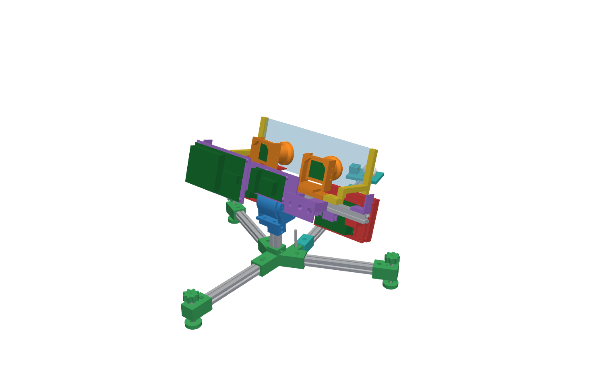
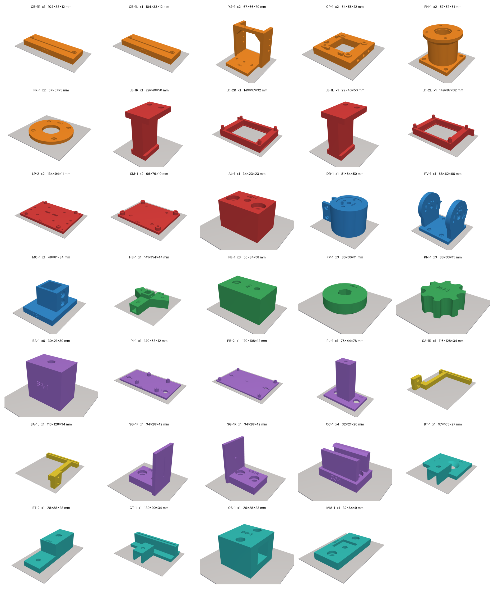
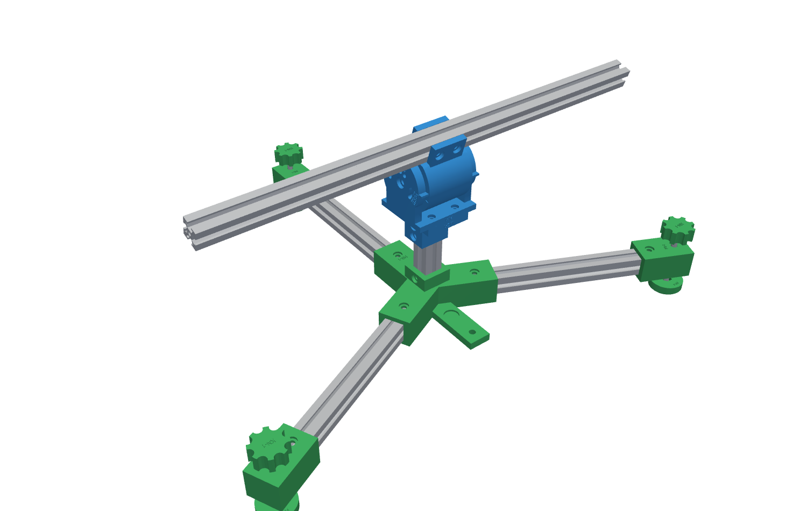
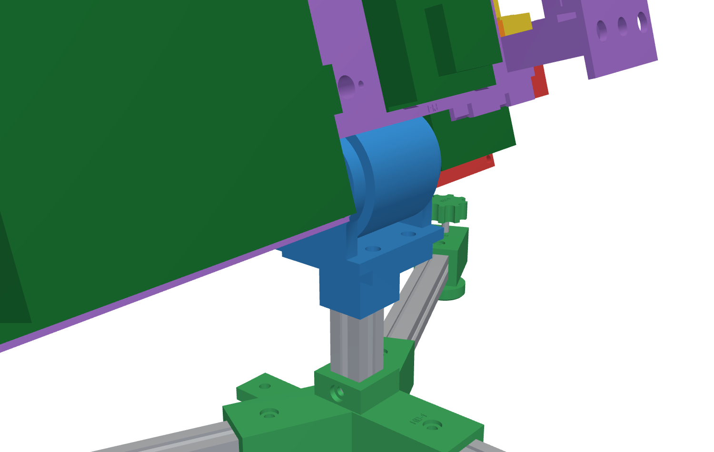
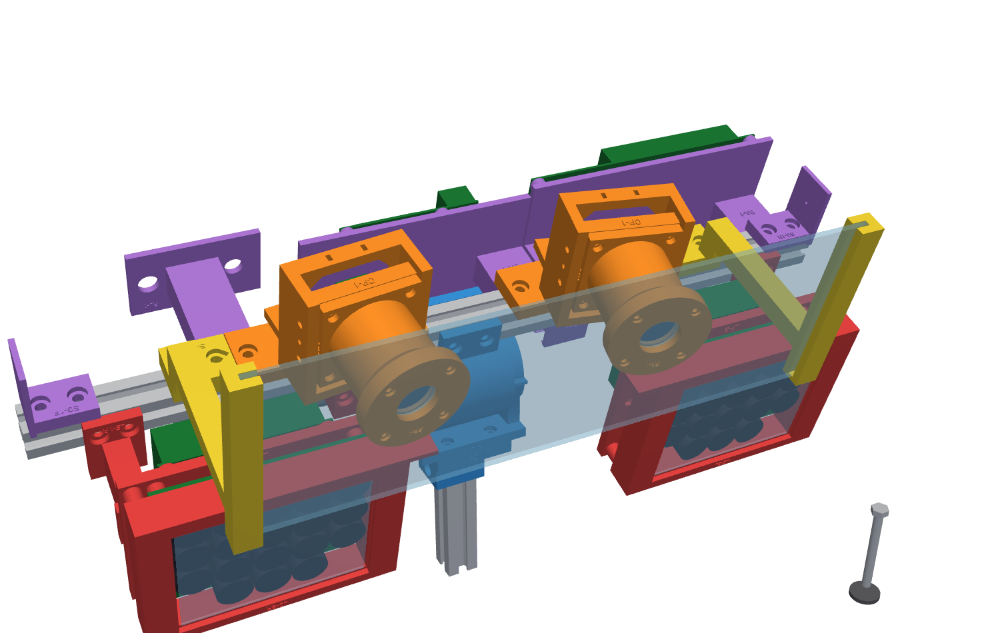
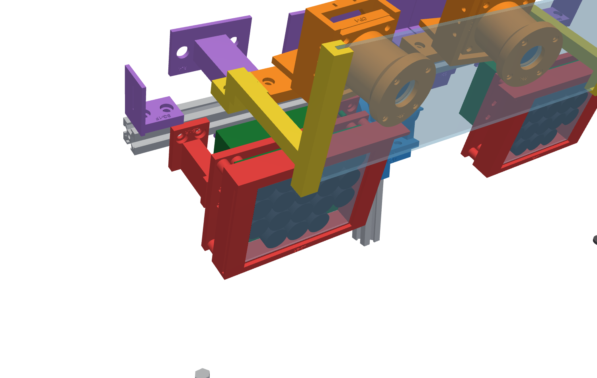
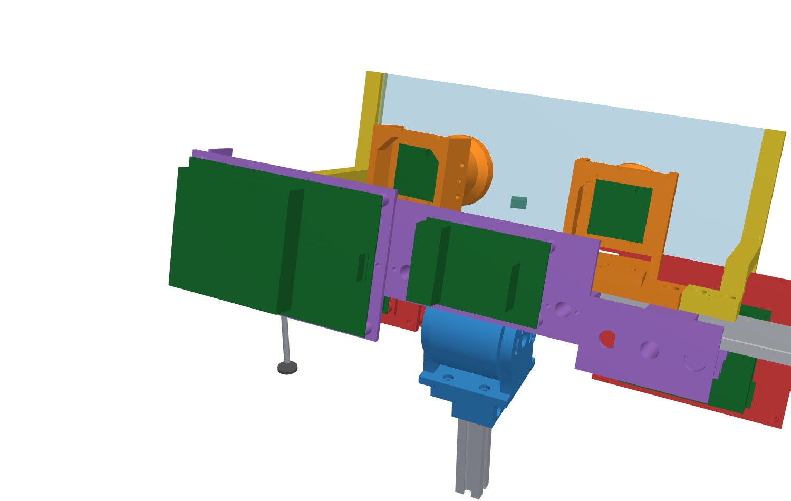
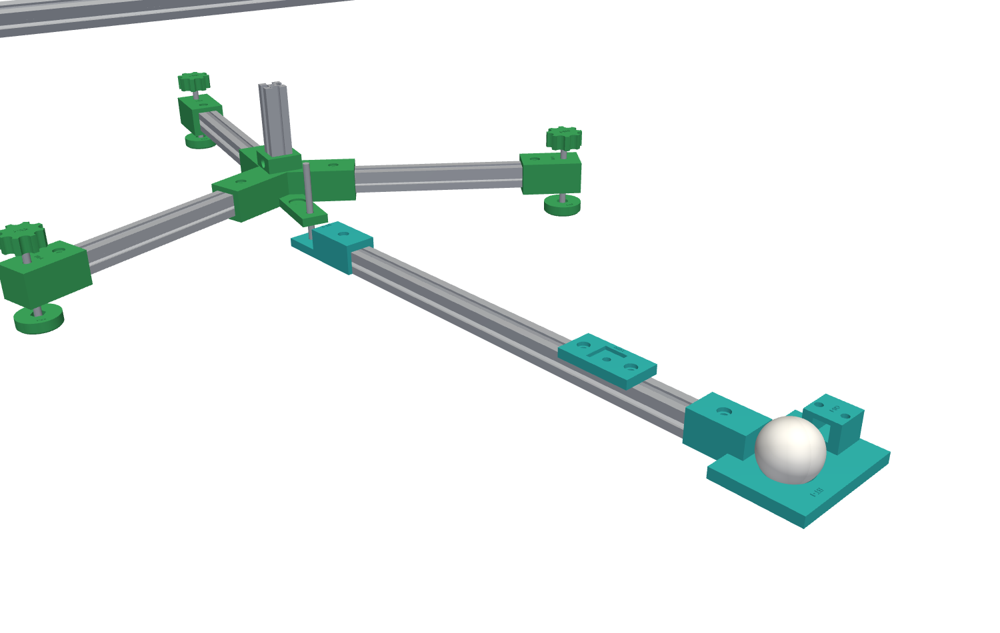

# 第一階段測試台（bench rig）

高爾夫發射監測器第一階段的 **3D 列印測試台**：用鋁擠型當結構樑，把 2 台 IMX296 全域快門相機、**2 片 IR LED 側板（各 18 顆 20 mm 星形板＋60° TIR 透鏡）**、2 片頻閃模組板、100 × 160 mm 控制板、Raspberry Pi 5 放在球的側面（球與測試台相距約 0.5 m），好讓量測軟體可以被驗證。它**不是**最終外殼。本版依 `hardware/electronics/README.md` 的機構需求（雙側 LED 板、模組板、控制板、12 V 插座、互鎖、ARMED 燈、麥克風、光學感測頭）改版。

> **誠實聲明：這是尚未列印、尚未組裝、尚未實測的設計。** 所有檢查都是在 CAD 模型上跑的幾何檢查（下面第 10 節列出實際跑過什麼、結果是什麼、哪些沒有驗證）。外購件尺寸全部是標稱值，**列印前必須先量測實物**（第 8 節）。
>
> **安全：** 測試台放在會被打偏的球打到的範圍內。透明聚碳酸酯（PC）護板只保護鏡頭那一側，其餘零件（LED、樹脂件、鋁條）都會被打壞或彈飛；打擊時請人員站在護板後方的安全位置，必要時再加擋網。850 nm 紅外頻閃近距離直視有風險，詳見 `docs/SPEC.md` 第 9 節，本設計未做眼睛安全評估。



## 1. 目錄

| 路徑 | 內容 |
|---|---|
| `params.py` | **所有尺寸**（附註解；外購件標 `VERIFY`） |
| `lib.py` `parts_cam.py` `parts_led.py` `parts_frame.py` | CadQuery 零件原始碼（英文註解） |
| `pose.py` `assembly.py` | 名義姿態數學、組合模型（含代理體） |
| `checks.py` `sweep.py` `optimize_fov.py` | 自動檢查、參數掃描、視野最佳化 |
| `previews.py` `render.py` | 無頭預覽圖（VTK offscreen、matplotlib） |
| `build.py` | **一個指令重新產生全部**（STL、STEP、檢查、圖） |
| `export/stl/*.stl` | 每個列印件一個 STL，**已是列印方向**（底面在 z = 0，置中） |
| `export/step/*.step` | 每個零件的 STEP（列印方向）＋ `assembly.step`（名義姿態、含代理體，代理體名稱以 `PROXY_` 開頭） |
| `export/check_report.json` / `.txt` | 檢查完整結果 |
| `docs/` | 預覽圖（總覽、剖面、細部、爆炸圖、每個零件、視野圖） |

## 2. 幾何與主要尺寸（目前 `params.py` 的值）

座標：世界座標原點在球正下方的墊面上，+X = 目標線（飛行方向），測試台站在 −Y 側往 +Y 看。樑座標 BF：+X 沿鋁樑，+Y 沿光軸方向，+Z 向上，原點在雙鏡頭中點、鋁樑中心線。

| 項目 | 值 |
|---|---|
| 立體基線 | 160 mm（參數 `BASELINE`，範圍 120–220） |
| 鏡頭光軸高度（離墊面） | 255 mm（`LENS_HEIGHT`，200–300） |
| 光瞳到球中心的水平距離 | 475 mm（`BALL_DIST`），沿光軸的距離：右機 562 mm、左機 532 mm |
| 名義俯仰（往下） | 17°（可調 15–25°；鎖定孔範圍 −3 到 30°） |
| 雙機中點相對球的位置 | 球的下游（+X）約 118 mm（`AIM_U`）；**桅桿在樑的中央**（頭部重心在桅桿上方），模板桿因此斜向 13.2° 指向球 |
| 名義內傾（toe-in） | 右機（+X 側）6.0°、左機（−X 側）9.0°，另有 ±5° 偏航、±4° 俯仰微調 |
| 鏡頭／感光元件 | f = 8 mm，5.02 × 3.75 mm → 半視角 17.4° × 13.2°（`FOCAL`、`SENSOR_W/H`） |
| IR LED 側板 | 兩片，中心 ±140 mm（`LED_X`；250 = 翼板位置），在鏡頭前平面、光軸與相機平行；鋁板 110 × 90 × 3 mm，5 × 4 格星形板位置用 18 個（`LED_SKIP` 空 2 格），透鏡高 15 mm（`LED_LENS_H`，8–15），板心離樑中心線高度 −26 mm（鏡頭光軸下方，因為相機罩佔用了鏡頭旁邊的空間） |
| 護板 | PC 板 322 × 110 × 3 mm（寬度由支臂間距推得，高度 `SHIELD_H`），蓋住兩台相機與兩片 LED 板的內側部分（±161 mm） |
| 鋁樑 | 480 mm，對稱（`BEAM_HALF` = max(240, LED_X + 84)；LED_X = 250 時 334 → 668 mm） |
| 三腳足點 | 半徑 271 mm（腿 230 mm），足點三角形約 491 mm 寬 × 386 mm 深，後腿朝 −Y |

為什麼是不對稱的內傾（6° / 9°）、俯仰 17°、高度 255 mm：`optimize_fov.py` 在這些參數下搜尋，讓**兩台相機同時**看到靜止的球（含 1° 邊界）和最長的飛行距離。數字見第 10 節。


## 3. 列印件清單與列印設定

**通用設定（所有零件）：** PETG；噴嘴 0.4 mm；層高 0.2 mm；牆 6 圈（2.4 mm，設計規則牆厚 ≥ 2.4 mm）；頂／底層各 5 層；**不使用支撐**（我們在 STL 上掃描過，見第 10 節）；噴嘴 235–245 °C、熱床 75–85 °C、風扇 30–50 %，橋接段速度降到 25–30 mm/s；STL 已經是建議的列印方向，直接切片即可。熱熔螺帽用烙鐵（約 220–240 °C）垂直壓入，壓到與表面齊平。需要遮光的零件（CP-1、FH-1、FR-1、LD-2）建議用**黑色** PETG。尺寸是列印方向的 X × Y × Z，質量是 PETG 密度 1.27 g/cm³ 乘等效實心率 0.5 的**估計值**。



| 編號 | 名稱 | 數量 | 尺寸 mm | 約重 g | 方向與重點設定 |
|---|---|---|---|---|---|
| CB-1R / CB-1L | 相機夾座（右／左，鏡像） | 各 1 | 104×33×12 | 21 | 鍵（T 槽定位鍵）朝上、頂面貼床；填充 60 %；鍵 1.6 mm 是定位鍵，不是承重牆 |
| YS-1 | 偏航台（含俯仰側板、排線固定橋） | 2 | 67×66×70 | 33 | 底板貼床、側板直立；填充 50 %；橋有 45° 肩，不需支撐；建議加 5 mm 邊沿（brim） |
| CP-1 | 相機板（板子定位塊、鏡頭窗、鉸鏈鑲嵌孔） | 2 | 54×55×12 | 12 | 前面貼床；填充 60 %；黑色；M2.5/M3 鑲嵌孔不要擴孔 |
| FH-1 | 濾鏡座（遮光筒＋850 nm 濾鏡座） | 2 | 57×57×51 | 24 | 法蘭貼床、筒直立；填充 40 %；黑色；內壁可噴消光黑 |
| FR-1 | 濾鏡壓環 | 2 | 57×57×5 | 5 | 平放；填充 100 %；黑色 |
| LE-1R / LE-1L | LED 板支臂（夾在樑前槽，2 顆 M5；凸緣用 2 顆 M3 + 螺母鎖背板） | 各 1 | 29×40×50 | 15 | 凸緣面貼床、臂朝上；填充 50 % |
| LP-2 | LED 背板（4 個鋁板柱、4 根框架柱鎖孔、螺母槽、走線窗） | 2 | 134×94×12 | 47 | 後面貼床、柱朝上；填充 40 %；螺母槽朝上（開口） |
| SM-1 | 頻閃模組載板（4 個 M3 柱，朝向樑） | 2 | 96×76×10 | 19 | 柱朝上；填充 40 % |
| LD-2R / LD-2L | 擴散片框＋擋光翼＋4 根柱（鏡像） | 各 1 | 149×97×32 | 59 | 前面貼床、柱朝上、擋光翼直立（3 mm 牆）；黑色；填充 30 % |
| AL-1 | ARMED 指示燈座（前方可見，Ø5.1 孔） | 1 | 34×23×23 | 10 | 後面貼床；填充 60 % |
| DR-1 | 俯仰鼓（含樑鞍） | 1 | 81×64×50 | 102 | 一端面貼床、鼓軸直立；填充 40 %，頂層 6 層 |
| PV-1 | 俯仰耳板（角度刻度、弧形鎖孔、定位銷孔） | 1 | 68×62×66 | 40 | 底板貼床；填充 50 %；耳板上的刻度只高 0.6 mm，第一層後保持 0.2 mm 層高 |
| MC-1 | 桅桿套環 | 1 | 48×61×34 | 21 | 法蘭貼床、套環朝上；填充 60 % |
| HB-1 | 底座輪轂（桅桿塔、三個腿套、模板耳） | 1 | 141×154×44 | 96 | 平放；填充 40 %；腿套的 20.4 mm 橋接是最大跨度 |
| FB-1 | 腳架套（含 M6 螺母槽） | 3 | 56×34×31 | 28 | 平放；填充 50 % |
| FP-1 | 腳墊盤 | 3 | 36×36×11 | 6 | 平放（橡膠凹槽朝下）；填充 100 % |
| KN-1 | 調整旋鈕 | 3 | 33×33×15 | 6 | 平放；填充 40 % |
| BA-1 | 後板支臂 | 4 | 30×21×30 | 10 | 後面貼床；填充 60 % |
| PI-1 | Raspberry Pi 5 板 | 1 | 140×68×12 | 25 | 前面貼床、柱朝上；填充 30 % |
| PB-2 | 100 × 160 mm 控制板座（Pico 在板子 +X 端，USB 朝 Pi 5） | 1 | 170×108×12 | 47 | 同上 |
| RJ-1 | 後面板支臂：12 V 插座（Ø11）＋互鎖開關（Ø12） | 1 | 76×44×79 | 32 | 面板貼床、臂直立；填充 50 % |
| SA-1R / SA-1L | 護板支臂（鏡像，從上槽升高越過 LED 框） | 各 1 | 116×128×34 | 29 | **側躺**（外側面貼床）；填充 60 % |
| SG-1F / SG-1R | 瞄準片（前：狹縫，後：小孔） | 各 1 | 34×28×42 | 6 | 塊貼床、片直立；填充 80 % |
| CC-1 | 線夾 | 4 | 32×21×20 | 4 | 底面貼床；填充 60 % |
| BT-1 | 球座（模板，含光學感測頭座的鑲嵌孔） | 1 | 97×105×27 | 47 | 平放；填充 30 % |
| BT-2 | 模板定位銷座 | 1 | 29×88×28 | 22 | 平放；填充 30 % |
| CT-1 | 校正卡座（與 BT-1 擇一裝在桿端） | 1 | 130×90×34 | 72 | 平放；填充 20 % |
| OS-1 | 光學感測頭座（感測面離球面 15 mm，鎖在 BT-1） | 1 | 27×28×23 | 8 | 平放；填充 60 % |
| MM-1 | 麥克風板座（夾在模板桿上，離球 150 mm） | 1 | 32×64×9 | 9 | 平放；填充 60 % |

估計列印總重約 1.2 kg（含模板零件），建議備 2 捲 1 kg PETG。

## 4. 外購件清單

**鋁擠型 2020（T 槽 6 mm，M5）**

| 用途 | 長度 | 備註 |
|---|---|---|
| 主樑（相機＋LED 板＋護板＋電路板） | 480 mm | `BEAM_LEN`；LED_X = 250 時 668 mm |
| 桅桿 | 100 mm | 長度由 `LENS_HEIGHT`、俯仰推得（`pose.MAST_LEN` = 100.3）。改高度要重切，見第 9 節 |
| 腿 | 3 × 230 mm | `LEG_LEN` |
| 模板桿 | 442 mm | 由底座位置推得（`pose.stick_len()` = 442.1） |
| 合計 | 約 1.7 m（LED_X = 250 時 1.9 m） | 買 2 m 加備料 |

**T 型螺母與螺絲（M5 全部用按鈕頭 ISO 7380 + 落入式 T 型螺母，槽 6）**

| 位置 | 數量 | 螺絲 |
|---|---|---|
| CB-1 ×2（相機夾座） | 4 | M5×16 |
| SA-1 ×2（護板支臂） | 4 | M5×16 |
| SG-1 ×2（瞄準片） | 4 | M5×12 |
| LE-1 ×2（LED 板支臂，每片 2 顆） | 4 | M5×12 |
| BA-1 ×4（後板支臂，用長六角扳手從管道伸入） | 4 | M5×12 |
| RJ-1（後面板支臂，管道長，需 ≥ 90 mm 六角扳手） | 1 | M5×12 |
| AL-1（ARMED 燈座，座厚 22 mm） | 2 | M5×25 |
| 樑鞍（DR-1，4 顆從側面） | 4 | M5×10 |
| 線夾 CC-1 ×4 | 8 | M5×10 |
| 輪轂：腿 3、桅桿夾 2 | 5 | M5×10 |
| FB-1 腳架套 ×3 | 3 | M5×10 |
| MC-1 桅桿套環 | 2 | M5×12 |
| 模板（BT-1、BT-2、MM-1；CT-1 與 BT-1 共用） | 3 | M5×12 |
| **合計** | **48 顆 M5、48 個 T 型螺母（另備少量備品）** | |

**其他螺絲／螺帽**

| 規格 | 數量 | 用途 |
|---|---|---|
| M6×60 六角頭螺栓、M6 六角螺母 | 3 螺栓、6 螺母 | 三個腳（螺母一顆卡在 FB-1，一顆黏在 FP-1） |
| M6×16 內六角 | 2 | 俯仰樞軸（耳→鼓） |
| M4×16 內六角＋墊圈 | 4（鎖定）＋2（定位銷，可選） | 俯仰鎖定 |
| M4×12 | 4 | PV-1 → MC-1 |
| M4×14 | 2 | 偏航樞軸（YS-1 → CB-1） |
| M3×12 內六角或按鈕頭 | 16 + 8 + 4 | 偏航鎖 4、俯仰鉸鏈 4、俯仰鎖 8；SM-1 → LP-2（8，各配 M3 螺母）；LE-1 凸緣 → LP-2（4，各配 M3 螺母） |
| M3×10 按鈕頭 | 8 + 8 + 8 | FH-1 → CP-1（8）、BA-1 → 後板（8）、LP-2 背面 → LD-2 柱（8） |
| M3×8 按鈕頭 | 8 + 4 + 8 + 8 | FR-1 → FH-1（8）、控制板（4）、頻閃模組板（8）、鋁板 → LP-2 柱（8） |
| M2.5×6 | 12 | 相機板 ×2（8）、Pi 5（4） |
| M2×6 | 若干 | 麥克風板、光學感測頭固定（視實物孔位，另備） |

**熱熔螺帽（黃銅）：** M2.5 ×12、M3 ×68（其中 8 顆為短型，長 4 mm，用在 FH-1 前端；另有 SM-1 / OS-1 / BT-1 的 M3 用法視實物）、M4 ×16（含 6 顆定位銷用，可先不裝）、M6 ×2。

**光學／電子／護板：**
- 2 × IMX296 MIPI 相機模組（38 × 38 mm、4 × M2.5 孔距 34 mm、CS 座）＋22 pin 排線（可用長度 ≤ 200 mm）
- 2 × 8 mm C／CS 鏡頭（最大 Ø35 × 45 mm）
- 2 × 850 nm 窄帶濾鏡，**Ø25 × 2 mm**
- **2 片 IR LED 側板**：各 18 顆 20 mm 星形板（850 nm）＋ 60° TIR 透鏡（高 8–15 mm，設計取 15）＋ 鋁板約 110 × 90 × 3 mm（4 角 M3 孔，距邊 5 mm，**待實測**）＋導熱墊／膏＋ **IR 可穿透擴散片 106 × 86 × 1.5 mm**（滑入 LD-2 的槽）
- **2 片頻閃模組板** 90 × 70 mm（最高元件約 25 mm，零件面朝樑；四角 M3 孔距邊 4 mm，待實測）；到 LED 板的線長 ≤ 15 cm（實際約 8 cm）
- **控制板** 100 × 160 mm（Pico 插在 +X 端、USB 朝 Pi 5）、Raspberry Pi 5 ＋官方 Active Cooler
- 12 V 桶形插座（面板孔 Ø11）、互鎖開關（面板孔 Ø12）、5 mm ARMED 指示燈（孔 Ø5.1，D7 或 J9 外接燈）
- 小型麥克風板（約 20 × 20 mm）、光學觸發感測頭（約 12 × 12 × 20 mm，連線 ≤ 1 m）
- **透明聚碳酸酯護板 322 × 110 × 3 mm**（PC，不要用壓克力，會裂）
- 3 × 黏貼橡膠腳 Ø20 × 3 mm、環氧膠／瞬間膠、1 顆 Ø15 mm 圓形水平泡、束線帶（寬 ≤ 3.6 mm）、黑色泡棉膠帶（遮光墊圈）、校正卡（3 mm 厚）

## 5. 組裝步驟（參考圖）

爆炸圖：


1. **熱熔螺帽**：依第 4 節把全部熱熔螺帽壓進對應的孔（CB-1、CP-1、FH-1、LP-2、LD-2、SM-1、DR-1、MC-1、BA-1、PB-2、PI-1）。
2. **底座**：HB-1 的三個腿套各插入一支 230 mm 鋁條（開槽朝上，M5 螺絲鎖進上方槽內的 T 型螺母）；腿端裝 FB-1；FB-1 底部嵌入 M6 螺母，M6×60 螺栓從上方旋入，螺栓下端黏上嵌有第二顆 M6 螺母的 FP-1（FP-1 底部貼橡膠腳）；螺栓頭套上 KN-1。細節圖：

   
3. **桅桿**：桅桿鋁條（100 mm）插入 HB-1 塔，用兩顆 M5 夾住；上端套上 MC-1 套環（兩顆 M5×12），再用 4 顆 M4×12 把 PV-1 鎖在 MC-1 上。
4. **俯仰鼓**：DR-1 夾在主樑下面：樑坐在鼓頂平面上，兩片樑鞍壁從前、後各用 2 顆 M5×10 鎖進樑的前槽、後槽。再把「鼓＋樑」放進 PV-1 的兩片耳板之間（耳內側離鼓端 0.6 mm），用兩顆 M6×16 當樞軸（從耳外穿過去旋入鼓端 M6 螺帽），再用 4 顆 M4×16 穿過弧形孔鎖進鼓端 M4 螺帽。
   - 角度刻度：耳板上有每 1° 一格的刻度（長刻度每 5°，數字 0/10/20/30），鼓端面有一條雕刻零線；零線指到哪格就是俯仰角（往下）。
   - **正向鎖定**：耳板上標 15 / 20 / 25 的三個孔，對準時把一顆 M4 螺絲穿過去擰進鼓端的對應螺帽，等於一根定位銷，比單靠摩擦更不會滑動。

   
5. **相機組（每台）**：CB-1 用 2 顆 M5×16 夾在樑的**上槽**（鍵進槽口，位置先照 160 mm 基線，之後可以滑動）→ YS-1 用 M4 樞軸＋2 顆 M3 鎖（弧形孔）鎖在 CB-1 上 → CP-1 用 M3 鉸鏈螺絲鎖在 YS-1 兩側板之間（鉸鏈＋每側 2 顆鎖，在側板長孔內）→ 相機板用 4 顆 M2.5 鎖在 CP-1 後面，板子靠兩條邊（下緣、左緣）的定位塊就位（**拆下再裝可回到同一位置**）→ FH-1 用 4 顆 M3 鎖在 CP-1 前面（貼一圈黑色泡棉當遮光墊圈）→ 鏡頭旋入 CS 座 → 濾鏡放進 FH-1 前端的座，FR-1 用 4 顆 M3 壓住。FPC 排線從相機板**上緣**出來，繞過 YS-1 上的橋，用束線帶綁在橋上（橋上有束線帶孔）。

   
6. **IR LED 側板（左、右各一組）**：LE-1 夾在樑前槽（2 顆 M5，位置在板心外側 58 mm，即 ±198 mm）；LE-1 的凸緣用 2 顆 M3 鎖在 LP-2 背面（螺母先放進 LP-2 前面的六角槽）；鋁板（貼好 18 顆星形板、導熱膏）用 4 顆 M3 鎖在 LP-2 前面的 4 根柱上，透鏡朝前；LD-2 用 4 根柱立在 LP-2 前面，從 LP-2 背面用 4 顆 M3×10 鎖進柱端螺帽；擴散片從 LD-2 的**外側**滑入槽內（以膠帶固定）；SM-1 用 4 顆 M3 鎖在 LP-2 背面，頻閃模組板（零件面朝樑）鎖在 SM-1 的柱上，電源與信號線穿過 LP-2 的走線窗到 LED 板（≤ 15 cm）。擋光翼在 LED 框上方，向內一路伸到鏡頭光軸附近，位於相機罩下方。AL-1（ARMED 燈座）夾在前槽 x = +70 mm，燈從 Ø5.1 孔向前露出。

   
7. **後板**：BA-1 夾在樑的**後槽**（每片板 2 個），M5 螺絲從 BA-1 後端的 Ø10.5 管道伸入（用長六角扳手）；再把 PI-1、PB-2 用 M3×10 鎖在 BA-1 後面（板上對應位置也有 Ø10.5 的通孔，日後不拆板也能鬆開 M5）；最後才把 Pi 5（CSI 邊朝上）、100 × 160 mm 控制板（Pico 在 +X 端，USB 朝 Pi 5）鎖在各自的柱上；RJ-1 夾在後槽 x = +130 mm，面板上裝 12 V 插座和互鎖開關；線夾 CC-1 夾在樑的下槽。

   
8. **護板**：SA-1R / SA-1L 夾在樑的上槽（距中點 ±150 mm），臂先升高越過 LED 框再往前；PC 板從上方滑入兩側的槽（板底落在槽底）。**打擊前一定要裝。**（板兩端各蓋到 ±161 mm，LED 板最外側 45 mm 在護板外。）
9. **瞄準片**：SG-1F（狹縫）夾在樑 +X 端，SG-1R（小孔）夾在 −X 端，兩片相距約 474 mm。
10. **模板**：BT-2 的 M6×80 螺栓（頭朝下嵌在底部）插入 HB-1 前方耳的孔；模板桿（442 mm 鋁條）夾進 BT-2 和 BT-1，M5×12 鎖緊（桿相對墊面前後軸約偏 13.2°，因為桅桿在樑中央）；OS-1 用 2 顆 M3 鎖在 BT-1 上（感測頭放進孔內，面向球、距球面 15 mm）；MM-1 夾在桿上離球 150 mm 處，麥克風板放進凹槽（收音孔朝上）。

   

## 6. 架設與瞄準程序

1. 把測試台放在擊球墊上（墊面當作 z = 0），擺好目標線：用一條拉直的線或一根長桿放在墊面上，通過球的位置、沿飛行方向。
2. **球位**：BT-2 的銷放進輪轂耳孔，模板桿往球的方向放到 BT-1，把球放進 BT-1 的圓錐座。球心就是名義原點（距耳孔 508 mm，桿與墊面前後軸約成 13.2°，球心離墊面 21.3 mm；桿長見 `pose.stick_len()`）。球放好後，模板（BT-2、桿、BT-1）可以整組拿掉，或留著當位置參考。
3. **水平**：用輪轂上的水平泡和三個腳（旋轉 KN-1）把輪轂調到水平（桅桿垂直）。
4. **俯仰**：鬆開 4 顆 M4，轉到需要的角度（預設 17°，可 15–25°；也可用 15 / 20 / 25 的定位銷孔），拴緊。改俯仰會改變視野，見第 10 節。
5. **平行目標線**：從 SG-1R 的小孔往 SG-1F 的狹縫看，把整機（連同三腳）轉到狹縫和遠處目標線上的標記（≥ 3 m 遠）重合；（模板桿因桅桿在樑中央，不再垂直於目標線；用球到相機中點的距離確認即可）。
6. **相機**：裝上鏡頭、濾鏡後對焦在約 560 mm（光軸到球距離），再放球看畫面：球應該在畫面**左下**（飛行方向朝右），邊界約 1.0–1.5°。用偏航（±5°）、俯仰（±4°）微調，鎖緊 M3 螺絲。因為塑膠件決定相機指向，兩台相機的外參一定要用 CT-1 + 棋盤格做**軟體立體校正**，不要相信 CAD 值。
7. 裝好 PC 護板，確認線都固定在線夾上，再通電測試。

## 7. 設計重點

- **基線由鋁擠型決定**：兩台相機的 CB-1 都夾在同一根 2020 上，樑的彎曲剛度 EI ≈ 5.5 × 10⁸ N·mm²（手算，I 由模型截面求得 7.86 × 10³ mm⁴）。全部頭部質量當點載重，兩片 LED 板、模組、Pi 5 等全部頭部質量計入後，右機垂直下垂約 4 µm、左機 5 µm、LED 板端約 10 µm。塑膠件只是夾住鋁條和決定指向（偏航／俯仰靠摩擦鎖），並不決定基線的剛度。
- **為什麼相機在樑上方、LED 臂在前槽、板在後槽**：上槽給相機（可滑動、有鍵定位）與護板、前槽給 LED 板支臂和 ARMED 燈、後槽給電路板和後面板、下槽給線夾，四個槽各有用途。LED 板放在鏡頭光軸下方 26 mm（板心 z = −26）：相機罩（Ø57）在 x = 51–108 佔住鏡頭旁邊的空間，所以 LED 板在 ±140 mm 時必須低於罩子底面。模組板放在 LED 背板後面（靠樑那一側），距 LED 板線長遠小於 15 cm。
- **桅桿在樑中央（改版）**：LED 板、模組、控制板加進來後，頭部重心離原本的桅桿位置（球正前方，樑上 x = −116 mm）太遠，而且左模組會撞到俯仰鼓，所以桅桿改放在樑中央；整機重心落在輪轂附近（重心 x 距輪轂 7 mm）。質量由 2.36 kg 增加到約 3.0 kg，重心餘量在 25° 俯仰時為 76.7 mm（改版前 79.4 mm），仍大於 60 mm 要求（第 10 節）。
- **偏航／俯仰**：偏航台以 M4 樞軸＋2 條 ±5° 的弧形孔＋2 顆 M3 鎖緊，名義內傾已經做在 CB-1 的螺帽位置裡（左、右鏡像，所以有 CB-1R / CB-1L）。俯仰以側板上的 M3 鉸鏈＋每側 2 顆鎖（±4°）。兩者都是「鬆開 → 調 → 鎖死」。
- **擋光翼**：LED 透鏡頂面（y = 90.6 mm）幾乎和相機鏡頭前端同一個平面，鏡頭在 LED 軸線的 90–92° 方向（略在 LED 後方），所以直射光本來就很少；但 TIR 透鏡邊緣有漏光，檢查用 100° 發光半角（保守）。沒有擋光翼時，36 顆發光點對兩個裸鏡頭全部 612 條線都是直視線；有擋光翼（LD-2 的框＋上方翼）時為 0。

## 8. 列印前必須量測的尺寸（`params.py`，標 `VERIFY`）

量實物，把真實值寫進 `params.py`，再 `python3 build.py`。

| 參數 | 目前值 | 量什麼 |
|---|---|---|
| `BUILD_VOLUME` | 220 × 220 × 250 | 印表機實際可用範圍 |
| `CLR`、`CLR_TIGHT` | 0.25 / 0.15 | 用你自己的印表機試印滑動配合與定位配合 |
| `EXT_SLOT_OPEN`、`EXT_LIP`、`EXT_CAV_W`、`EXT_CAV_D` | 6.2 / 1.8 / 11.0 / 6.1 | 2020 鋁條的槽口寬、唇厚、T 槽寬、T 槽深（不同廠牌不同） |
| `EXT_MASS_PER_M` | 520 g/m | 鋁條重量（只影響重心估計） |
| `INSERT_M25_D/L`、`INSERT_M3_D/L`、`INSERT_M3_SHORT_L`、`INSERT_M4_D/L`、`INSERT_M6_D/L` | 3.6/4.5、4.2/5.7、4.4、5.6/5.5、8.0/10.0 | 你買的熱熔螺帽的外徑與長度（照廠商建議孔徑，**先在廢料上試壓**） |
| `NUT_M6_AF`、`NUT_M6_H` | 10.4、5.5 | M6 螺母對邊與厚度 |
| `ZIP_W`、`ZIP_T` | 3.6、1.6 | 束線帶寬度與厚度 |
| `CAM_PCB`、`CAM_PCB_T` | 38 mm、1.6 mm | 相機板外形與板厚 |
| `CAM_HOLE_SQ` | 34 mm | 4 個 M2.5 孔的方形邊長 |
| `CAM_HOLDER_W`、`CAM_HOLDER_H` | 27 mm、11 mm | CS 座本體寬度（**不能超過約 28 mm**，否則碰到固定螺絲）、板面到鏡頭接環面的高度 |
| `CAM_REAR_H`、`CAM_CONN_W`、`CAM_CONN_D` | 5、17、5 | 板背面最高零件（排線座）高度、排線座長度與深度 |
| `CAM_FPC_LEN`、`CAM_FPC_EDGE` | 200 mm、`top` | 排線長度；排線若從下緣出來，板子倒裝即可（影像轉 180°） |
| `LENS_D`、`LENS_L`、`LENS_PUPIL` | 35、45、28 | 鏡頭最大外徑、最大長度、入瞳位置（離接環面） |
| `FILTER_D`、`FILTER_T`、`FILTER_APERTURE` | 25、2、23 | 濾鏡外徑、厚度、保留的通光孔徑 |
| `LED_PLATE`、`LED_PLATE_HOLE_INSET` | 110×90×3、5 | LED 鋁板外形、4 角孔邊距 |
| `LED_STAR_D`、`LED_STAR_T`、`LED_LENS_H`、`LED_GRID`、`LED_SKIP` | 20、1.6、15、5×4、空 2 格 | 星形板直徑、板厚、TIR 透鏡高度（8–15）、星形板格子與未使用的 2 個位置 |
| `LED_HALF_ANGLE`、`LED_X`、`LED_ZC` | 100°、140、−26 | 檢查用發光半角；LED 板中心離樑中心線的距離（250 = 翼板）；板心高度 |
| `MOD`、`MOD_HOLE_INSET`、`MOD_PARTS_H` | 90×70×1.6、4、25 | 頻閃模組板外形、孔邊距、最高元件（電容橫放） |
| `CTRL`、`CTRL_HOLE_INSET`、`CTRL_COMP_H`、`PICO_HEADER_H` | 160×100×1.6、4、20、9 | 控制板外形（X × Z）、孔邊距、最高元件、Pico 排針／USB 高度 |
| `JACK_D`、`SWITCH_D`、`ARMED_LED_D` | 11、12、5.1 | 12 V 插座孔、互鎖開關孔、ARMED 燈孔 |
| `MIC_BOARD`、`MIC_FROM_BALL`、`SENSOR_HEAD`、`SENSOR_GAP` | 20×20×1.6、150、12×12×20、15 | 麥克風板、離球距離（≤ 200）、感測頭外形、感測面離球距離（10–20） |
| `DIFFUSER_T` | 1.5 | 擴散片厚度 |
| `PI_*` | 85×56、孔距 58×49、Active Cooler 高 17 | Pi 5 板外形、孔距、散熱器尺寸；`PI_CSI`（CSI 接口位置）要量 |
| `RUBBER_D`、`BUBBLE_D` | 20、15 | 橡膠腳與水平泡直徑 |
| `SHIELD_H`、`SHIELD_T` | 110、3 | PC 板高度與實際厚度（寬度由支臂間距推得） |
| `CARD` | 3 × 120 | 校正卡厚度與寬度 |
| `FOCAL`、`SENSOR_W/H` | 8、5.02、3.75 | 鏡頭焦距與感光元件尺寸（視野檢查用，查原廠資料） |

## 9. 如何改參數並重新產生

```bash
pip install cadquery trimesh manifold3d embreex rtree networkx vtk matplotlib numpy scipy pillow
cd hardware/enclosure
python3 build.py                 # 全部：STL、STEP、檢查、掃描、預覽圖（約 6 分鐘）
python3 build.py --no-sweep      # 略過參數掃描（約 1 分鐘）
python3 build.py --no-render --no-sweep --quick   # 只重新產生 STL 並跑檢查
python3 optimize_fov.py          # 目前參數下，最佳內傾角與涵蓋距離
python3 optimize_fov.py --all    # 同時掃描俯仰與鏡頭高度
python3 sweep.py                 # LED 板中心 100/140/180/250、基線 120/220 的完整檢查
```

- 改 `BASELINE` 後，先跑 `optimize_fov.py`，把 `TOE_IN_R`、`TOE_IN_L` 改成它給的值。
- 改 `LENS_HEIGHT` 或 `PITCH_NOM` 後，桅桿長度會變（`pose.MAST_LEN`），**重切桅桿**，並再跑一次 `optimize_fov.py`。目前的高度範圍（用同一根桅桿，腳 0–30 mm）：俯仰 17° 時 241–271 mm。要到 300 mm 桅桿切到約 145 mm；要低到 200 mm，需要俯仰 ≥ 約 20° 並把腳縮到底（預設輪轂塔與套環在腳縮到底時，最低高度是俯仰 15°：208、17°：205、25°：191 mm）。
- 改 `LED_X`（板中心距離）：LE-1、LD-2、樑長度（`BEAM_HALF`）會自動跟著變；`LED_X` 太小（約 < 120）時頻閃模組會撞到 ARMED 燈座 AL-1（可改 `AL_X`）。
- 環境變數 `RIG_OVERRIDES='{"BASELINE":120}'` 可以不改檔案就覆寫參數（掃描就是這樣做的）。

## 10. 自動檢查（實際跑過的結果）

跑法：`python3 build.py`；完整報告在 `export/check_report.txt` / `.json`。

| 檢查 | 做法 | 結果 |
|---|---|---|
| 建置體積 | 34 個 STL 的外框 ≤ 220 × 220 × 250，底面在 z = 0 | 全部通過；最大 PB-2 170 × 108 × 12、HB-1 141 × 154 × 44 mm |
| 水密 | trimesh 載入每個 STL：`is_watertight`、`is_winding_consistent`、體積 > 0 | 34 個全部通過；每個零件都是單一實體 |
| 干涉 | 99 個本體（51 個列印件、48 個代理體：鋁條、相機板、鏡頭、濾鏡、LED 鋁板／星形板／透鏡／擴散片、頻閃模組、控制板、Pico、Pi 5、護板、球、墊面、麥克風、感測頭……）兩兩做布林交集（manifold3d），門檻 0.5 mm³ | 0 對重疊（名義姿態、俯仰 17°） |
| 調整範圍 | 把整機俯仰掃到 −3 / 0 / 15 / 25 / 30°，兩台相機的偏航 ±5°、俯仰 ±4°，各做一次干涉檢查（LED 板現在是固定的，沒有調整軸） | 全部沒有重疊（過程中發現相機罩往下傾 4° 會碰到擋光翼，已把 LED 板降低 4 mm 解決） |
| 視野 | 8 mm 鏡頭、5.02 × 3.75 mm；半視角 17.4° × 13.2°，額外 1.0° 邊界；從入瞳對視野內 221 條光線＋球＋飛行點投射到所有零件（含 LED 框、擋光翼、護板、支臂） | 兩台相機都看得到靜止的球（邊界：右機 1.45°、左機 1.01°），**沒有任何光線被零件擋住**，所有光線都穿過護板的有效範圍（離板邊 ≥ 34 mm） |
| 飛行涵蓋 | 直線飛行、各發射角，球整顆留在**兩台**視野內的最大下游距離 | 發射角 0° / 15° / 30°：262 / 258 / 250 mm（達到 250 mm 目標）；**45°：172 mm**（受限於垂直視野只有 ±13.2°，不是遮擋；與改版前相同） |
| LED 直視線 | **兩片板** 36 個發光點（透鏡頂面）× 17 個鏡頭取樣點 = 612 條線／每台相機，發光半角取 100° | 組裝後 0 條直視線（全被 LD-2 的框／翼擋住）；擋光翼單獨（拆掉濾鏡座與護板支臂、鏡頭裸露）也是 0 條；對照組（拆掉擋光翼）612 條全是直視線，證明檢查會失敗；鏡頭相對 LED 軸線在 90.3° 以外（鏡頭略在 LED 後方），所以真正的風險只有透鏡邊緣漏光；LED 到球沒有被擋（36/36） |
| 重心 | 全機重心投影到足點三角形，要求離邊 ≥ 60 mm | 俯仰 0° / 17° / 25°：離邊 88 / 80 / 77 mm；總質量約 2.99 kg（估計）；傾倒角約 24.5°。最高設定（鏡頭 300 mm、俯仰 25°）：離邊 77 mm、傾倒角約 20.8° |
| FPC 長度 | Pi 5 的 CSI 接口 → 上橋 → 相機排線座，折彎和餘量各 10 mm | 最長 165 mm（排線 200 mm 夠用）；基線 220 mm 時 187 mm |
| 護板眩光 | LED 在護板上的鏡面反射是否落在鏡頭視野內 | 沒有（離視野邊緣 ≥ 30°；改版前 53°，因為護板現在蓋住 LED 板的內側） |
| 懸挑檢查 | 在列印方向的 STL 上找 > 45° 且沒貼床的向下面；水平面用水力直徑估橋接跨度 | 34 個零件都不需要支撐；最大橋接 24 mm（HB-1 的 20.4 mm 腿套） |
| 牆厚掃描 | 對每個零件表面 6000 個取樣點朝內射線 | 薄於 2.4 mm 的面積都小於 6 %，幾乎都是設計上就薄的特徵：CB-1 的 1.6 mm 定位鍵、凸字和刻度（0.6 mm）、耳板上的指針（2 mm）、旋鈕花紋稜線、線夾倒鉤、球座圓錐邊緣 |

### 參數掃描（`sweep.py`，每一種都重新建立整個組合模型再檢查）

| 變化 | 結果 |
|---|---|
| LED 板中心 ±100 mm | **失敗**：頻閃模組（高 25 mm）與 ARMED 燈座 AL-1 互相干涉，LE-1 與線夾 CC-1 也擦到（可把 `AL_X`、`CLIP_X` 移開再試；未驗證） |
| LED 板中心 ±140 mm（預設）、±180 mm、±250 mm（翼板） | 全部通過（無干涉、視野沒被擋、無直視線、重心餘量 ≥ 60 mm）；±250 mm 時樑加長到 668 mm，護板不再蓋到 LED 板 |
| 基線 120 mm（內傾 4°/7°） | 通過；30° 發射角涵蓋 248 mm（略低於 250） |
| 基線 220 mm（內傾 9°/11°） | 通過；30° 發射角涵蓋 244 mm；FPC 路徑 187 mm，接近 200 mm 上限 |

## 11. 未驗證與已知風險

- 沒有列印、沒有組裝。所有外購件尺寸都是標稱值；T 槽斷面、熱熔螺帽、相機模組（包含 CS 座寬度、板背高度、入瞳位置）都可能與實物不同。
- 視野是針孔模型：不含鏡頭畸變、不含邊緣暗角；入瞳位置（`LENS_PUPIL` = 28 mm）是假設。濾鏡座通光孔 Ø23 mm，離入瞳約 23 mm，邊角有可能出現些微暗角（邊角光線已避開 1.0° 邊界，中心光線不受影響）。
- 摩擦鎖（偏航、俯仰、樑鞍）的實際保持力與蠕變（PETG 壓緊後的鬆弛）沒有量；每次搬動後請重新做立體校正。
- 質量是估計值（等效實心率 0.5），重心檢查依賴它；樑的剛度只是手算（不含塑膠件）。
- LED 發光角假設 100°（保守），「直視線」只是幾何上的直線檢查，沒有模擬散射、反射（除了護板的鏡面反射）。透鏡高度取 15 mm（上限），星形板與透鏡尺寸是標稱值。
- 頻閃模組零件面朝樑；2200 µF 電容假設橫放，若直立會碰到樑／臂。模組到 LED 板的線長只是幾何估計（約 8 cm）。
- 互鎖開關位置是 RJ-1 面板上的 Ø12 孔（一個面板開關位置），不是護板到位開關；ARMED 燈座在前槽，從球那一側看得到。
- 麥克風離球 150 mm、光學感測頭離球面 15 mm 只靠模板桿與 BT-1 定位；這兩個零件實打時會被球桿打到，只適合調整階段使用。
- 整機質量約 3 kg（改版前 2.4 kg），俯仰鎖與樑鞍的摩擦負荷增加，必須實測。
- 懸挑／橋接掃描是幾何估計，切片軟體的實際結果可能不同；SA-1 立柱（14 × 13 mm，高 110 mm）比較細，若列印後搖晃，請加黏貼或支撐。
- 俯仰到 15° 時，45° 發射角的涵蓋距離只有約 170 mm；更高的球要換視野更大的鏡頭（例如 6 mm）。
- 鏡頭高度 200 mm 只有在俯仰 ≥ 約 20° 才做得到（第 9 節）。
- 球與墊面的位置是用名義尺寸；模板的尺寸誤差（鋁條長度、孔位）直接變成球位誤差，建議實測一次後把 `pose.stick_len()` 的長度當作基準重切桿。模板桿因桅桿在樑中央，相對墊面的前後軸偏 13.2°。

## 12. 預覽圖索引

| 圖 | 檔案 |
|---|---|
| 總覽（等角） | `docs/assembly_iso.png`、`assembly_iso_back.png`、`assembly_iso_ball_side.png` |
| 正視、側視、俯視、後視 | `docs/assembly_front.png`、`assembly_side.png`、`assembly_top.png`、`assembly_rear.png` |
| 細部 | `docs/detail_cameras.png`、`detail_led.png`、`detail_led_rear.png`、`detail_pivot.png`、`detail_pivot_side.png`、`detail_hub_feet.png`、`detail_rear_boards.png`、`detail_template.png` |
| 爆炸圖 | `docs/exploded.png`、`docs/exploded_side.png` |
| 每個零件（列印方向） | `docs/parts/*.png`、總表 `docs/parts_sheet.png` |
| 相機看到什麼 | `docs/fov.png` |
