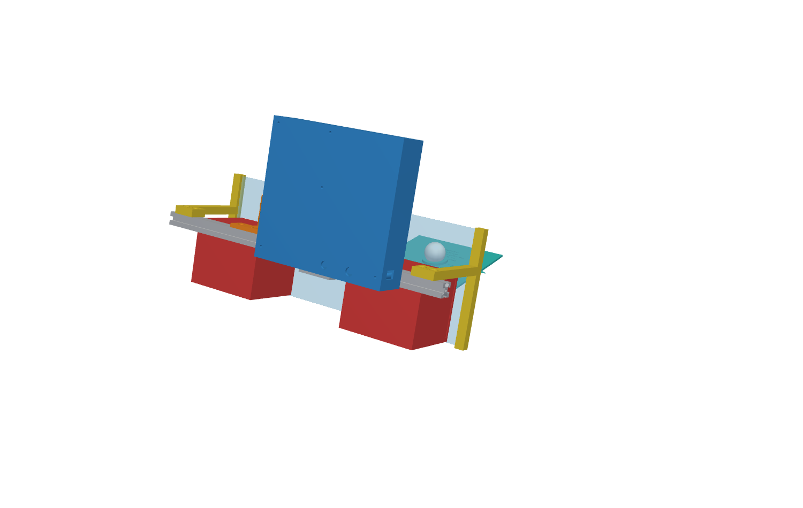
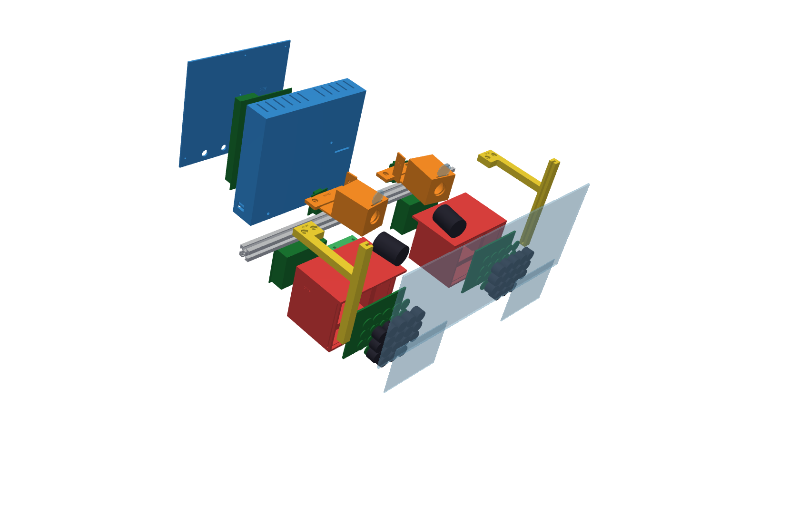
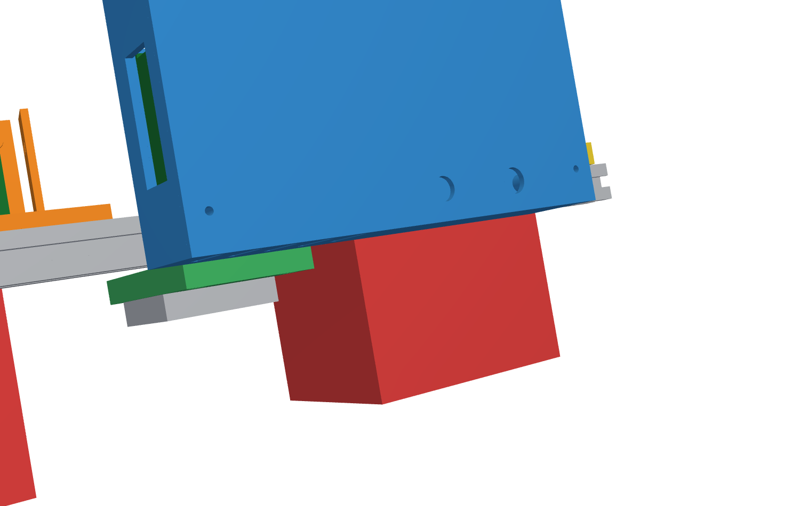
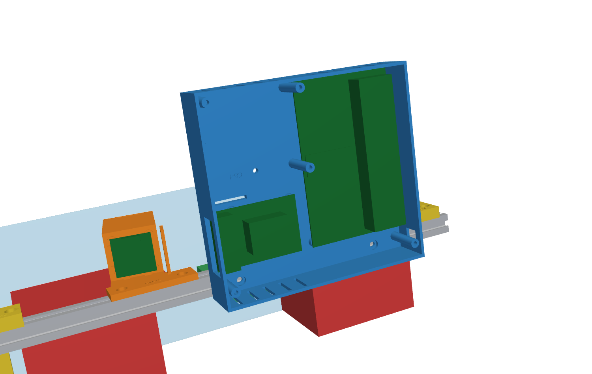
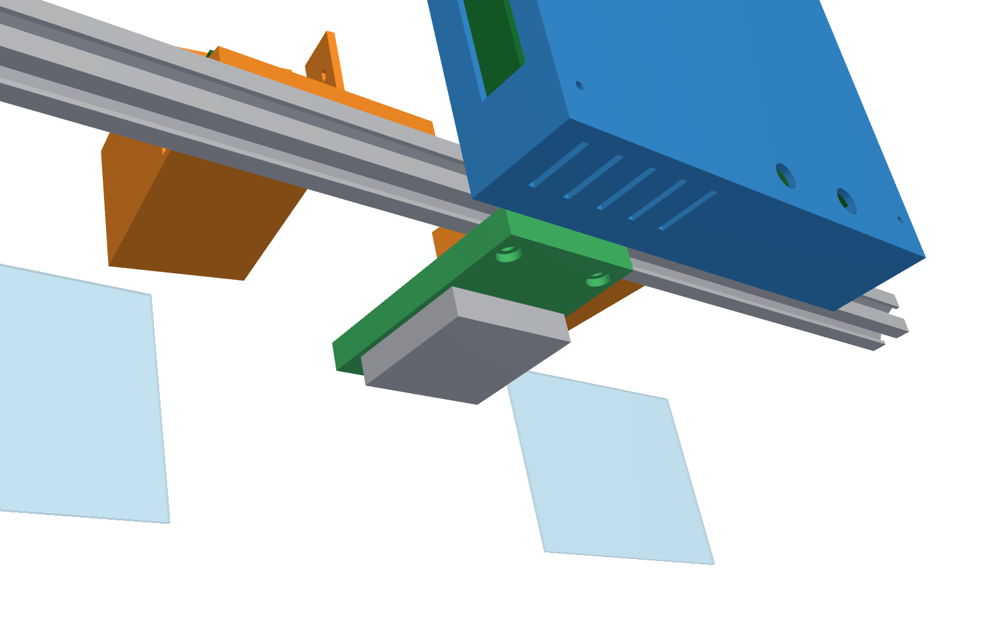
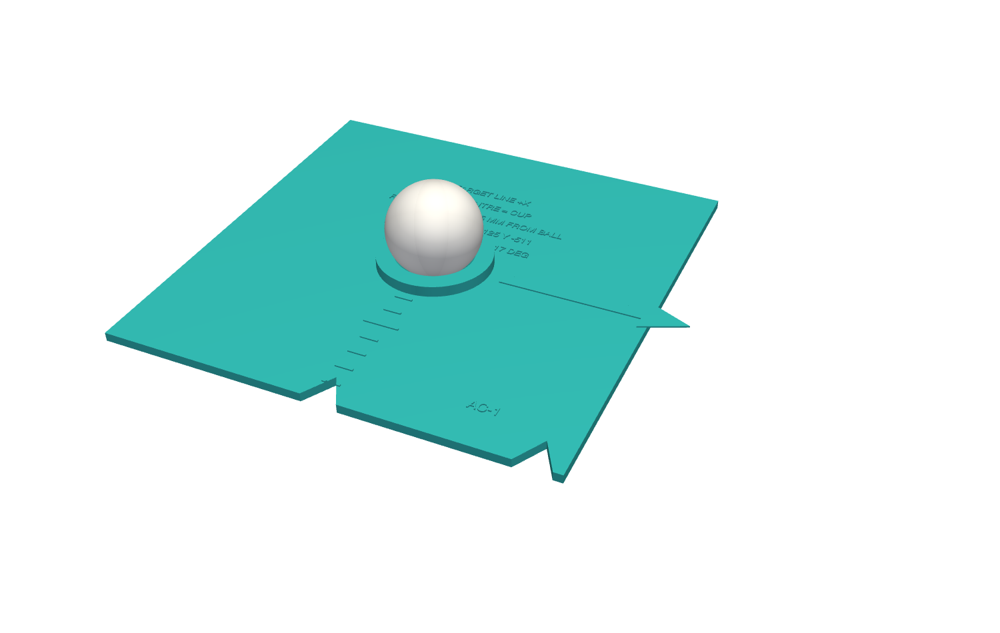
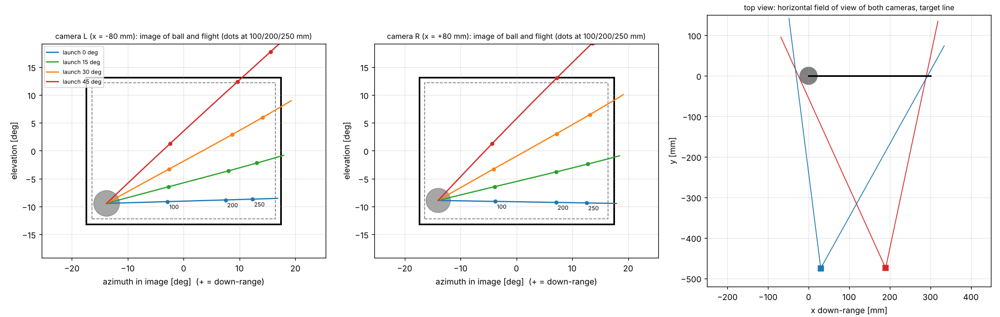

# 高爾夫發射監測儀 第一階段測試台（簡化版）

> **狀態：尚未列印、尚未組裝。** 本資料夾的所有尺寸都來自 CAD 模型與自動檢查，沒有任何一件實物驗證過。
> 凡標示 `VERIFY` 的數值是外購零件的標稱值，列印前必須用卡尺實測並改 `params.py`，再執行 `python3 build.py`。

一支 2020 鋁擠型橫樑，上面夾著兩台相機、兩塊 LED 板、電子盒、PC 護板夾和一個三腳架轉接件。三腳架（相機用腳架加可鎖雲台）負責高度、俯仰和水平；沒有印刷的腳、輪轂、立柱、俯仰鼓或腳墊。相機內收角（toe-in）直接做進相機座，不可調。

| 項目 | 數值 |
|---|---|
| 列印件設計 | 7 種設計、10 件（CM-1 ×2、LT-1 ×2、SC-1 ×2、EB-1、EL-1、TA-1、AC-1） |
| 橫樑 | 一支 2020，名義長度 **480 mm**（LED 偏移 ±140 mm） |
| 基線 | 160 mm（兩個瞳孔 x = ±80 mm） |
| 鏡頭軸高度 | 255 mm（離墊面） |
| 名義俯仰 | 17°（整支橫樑由雲台下壓） |
| 瞳孔中心到球 | 水平 475 mm；瞳孔中心在球的下游 110 mm |
| 內收角（固定） | 右機 6.0°、左機 10.5°（`optimize_fov.py` 重新最佳化） |
| 估計機頭質量 | 約 2.46 kg（含電子零件；列印件按 50 % 有效填充估算） |
| 三腳架螺柱高度 | 名義俯仰 17° 時，雲台頂面約離墊面 **206.5 mm** |

座標：BF 橫樑座標（+X 沿橫樑，+Y 朝球，+Z 向上，原點在雙機中心的橫樑中心線）；WF 世界座標（原點在球正下方的墊面，+X 為目標線，鏡頭組在 −Y 側）。



---

## 1. 零件清單與列印設定

通用設定（`VERIFY`，依你的機器調整）：噴嘴 0.4 mm、層高 0.2 mm、PETG（或 ASA）、牆至少 6 圈（2.4 mm）、填充 40–50 %。**全部零件已按「不需支撐」設計**（自動掃描見第 7 節）；不要開支撐。熱熔螺帽（heat-set insert）只用在會反覆拆裝的地方。孔與螺絲沉頭座用 M5 鈕扣頭（ISO 7380）。

| 零件 | 數量 | 外形 mm（列印方向） | 估計質量 | 列印朝上面 | 說明 |
|---|---|---|---|---|---|
| CM-1R / CM-1L 相機座 | 各 1 | 80 × 110 × 50 | 66 g | 夾橫樑的底板貼床 | 夾在橫樑頂槽（2×M5）；放 IMX296 板（38×38，4×M2.5，34 mm 孔距）；內建濾光片 Ø25×2 槽（頂部開口，加蓋用膠帶或黑色泡棉）；遮光罩；內建 6° / 10.5° 的偏航；FPC 紮線耳（內側，兩條排線都短）。無偏航或俯仰調整 |
| LT-1R / LT-1L LED 板座 | 各 1 | 142 × 99 × 96 | 172 g | 夾橫樑的背板貼床 | 夾在橫樑前槽（2×M5）；鋁板 110×90×3 用 4×M3 熱熔螺帽固定；整合隧道（擋光，每顆 LED 看不到鏡頭）、向內的擋光翼、外側擴散片插槽（IR 擴散片 1.5 mm）；90×70 閃光模組裝在鋁板背面的 4 根立柱上（線長 ≤ 15 cm，實際 < 5 cm） |
| SC-1R / SC-1L 護板夾 | 各 1 | 171 × 132 × 34 | 33 g | 外側面貼床 | 夾橫樑頂槽（2×M5，在 x = ±210）；8 mm 深的槽夾住 3 mm PC 板（442 × 166 mm），蓋住兩台相機和兩塊 LED 板（板面後方 8 mm 以上，不進入視野） |
| EB-1 電子盒 | 1 | 207 × 193 × 44 | 212 g | 前壁貼床 | Pi 5（58×49 孔距，M2.5）、控制板 100×160（Pico USB 朝向 Pi）、通風槽、Pi 的 USB/ETH 側窗、CSI 排線槽、ARMED LED Ø5.1 孔、夾橫樑後槽（2×M5）。**一件，不需分割**（207×193 < 220×220） |
| EL-1 盒蓋 | 1 | 207 × 193 × 3.6 | 76 g | 外面貼床 | 5×M3；12 V 插孔 Ø11；互鎖開關 Ø12 |
| TA-1 三腳架轉接件 | 1 | 61 × 102 × 12 | 44 g | 貼橫樑面朝上 | 夾在橫樑底槽（2×M5）；1/4"-20 螺帽置入六角槽（被橫樑面夾住）；另有可選 3/8"-16 位置；螺柱位置依機頭重心定（見第 6 節） |
| AC-1 對位卡 | 1 | 216 × 200 × 9 | 105 g | 平放 | 放在墊面，球杯/環、目標線箭頭、公稱距離、對位缺口。**打擊前拿走** |


每個零件上都有壓印的零件編號。每個零件的 STL / STEP 在 `export/stl/`、`export/step/`；整機組裝在 `export/step/assembly.step`。

麥克風：**不做固定座**。麥克風板放在墊面上，**不能在桿頭路徑上**。建議位置（`VERIFY`，實測訊號後調整）：離球約 150 mm、在鏡頭組那一側（球的 −Y 側），x 約 −40 mm（球的後方）；這離球 < 20 cm，又在桿頭擺動範圍外（桿頭沿 +X 通過球，桿面偏差在 ±50 mm 內）；用泡棉墊隔開墊子，電纜沿墊面向鏡頭組拉。

---

## 2. 硬體清單

| 項目 | 數量 | 說明 |
|---|---|---|
| 2020 T 槽鋁擠型 | 1 支 **480 mm** | 四面都有槽。LED 偏移 ±200 mm 需 **584 mm**（約 600），±250 mm 需 **684 mm**（約 700），且護板夾要移到 LED 偏移 +72 mm，PC 板也要加寬（掃描用 `SHIELD_X_ARM = LED_X + 72`） |
| M5 落入式 T 型螺帽 | 16 | 頂槽 8（相機 4、護板夾 4）、前槽 4（LED）、後槽 2（電子盒）、底槽 2（轉接件） |
| M5 鈕扣頭螺絲 ISO 7380 | 16 | CM-1 ×4：M5×10；LT-1 ×4：M5×10；EB-1 ×2：M5×10；SC-1 ×4：M5×16；TA-1 ×2：M5×16（長度依 T 型螺帽實測，`VERIFY`） |
| 熱熔螺帽 M2.5（外徑孔 3.6 × 4.5 深） | 12 | CM-1 ×8（相機板）、EB-1 ×4（Pi） |
| 熱熔螺帽 M3（孔 4.2；短版 4.4 深，標準 5.7 深） | 25 | LT-1：短版 ×8（鋁板）、標準 ×8（閃光模組）；EB-1：標準 ×9（5 蓋 + 4 控制板） |
| M2.5 螺絲 | 12 | 相機板 4×M2.5×6（每台相機 4 顆，共 8）、Pi 4×M2.5×6 |
| M3 螺絲 | 25 | 鋁板與模組 M3×8、盒蓋 M3×10、控制板 M3×8 |
| 1/4"-20 六角螺帽 | 1 | 放 TA-1 六角槽（對邊 11.1 mm + 間隙） |
| 3/8"-16 六角螺帽 | 0–1 | 只有三腳架用 3/8" 螺柱時才用 |
| 850 nm 帶通濾光片 Ø25 × 2 mm | 2 | 放在 CM-1 的槽內 |
| IMX296 相機板 38×38 + CS 鏡頭 8 mm | 2 | 孔距 34 mm、鏡頭外徑 ≤ 35、長 ≤ 45 mm（`VERIFY`） |
| FPC 排線 ≤ 200 mm | 2 | Pi 5 的兩個 CSI 到兩台相機（估計走線 167–182 mm，見第 7 節） |
| 束線帶 2.5 mm | 4 | 排線固定耳每台 2 個（槽 2.4×4.2 mm） |
| 鋁板 110×90×3 mm | 2 | 每板 18 顆 20 mm 星形 MCPCB、TIR 透鏡 8–15 mm 高 |
| 90×70 閃光模組 | 2 | 零件高度 ≤ 25 mm |
| Raspberry Pi 5 + 主動散熱器（高 ≤ 17 mm） | 1 | |
| 控制板 100×160 | 1 | Pico 在板上，USB 朝向 Pi（`VERIFY` 板上元件高度 ≤ 20 mm） |
| 12 V 插孔（面板式，Ø11 孔） | 1 | 在盒蓋 |
| 互鎖開關（Ø12 孔） | 1 | 在盒蓋 |
| ARMED LED Ø5 | 1 | 在盒前壁（兩台相機之間可見） |
| 聚碳酸酯板 442 × 166 × 3 mm | 1 | 護板（`VERIFY` 厚度；孔位不需要） |
| IR 擴散片（1.5 mm，每塊 ≈ 108 × 86 mm） | 2 | 插進 LT-1 外側的槽 |
| 相機三腳架 + 可鎖雲台 | 1 | 見下 |

### 三腳架要求

- **承重 ≥ 2 × 機頭質量**：機頭約 2.46 kg，所以承重至少 **5 kg**（建議 ≥ 8 kg 並有中柱鎖）。
- 雲台可鎖定平移與俯仰；俯仰範圍至少 −25°（整機名義下壓 17°）。
- 1/4"-20 公螺柱（或 3/8"-16 配可選位置）；雲台頂板至少 55 × 55 mm（轉接件模型取 55 × 55 × 12，`VERIFY`）。
- 雲台頂面高度（名義俯仰 17°）約離墊面 **206.5 mm**；鏡頭軸 255 mm 由此決定。
- 螺柱位置：BF x = +15.2 mm、y = +52.1 mm（在橫樑底下、橫樑前方，在機頭重心正下方）；名義俯仰時重心偏離螺柱 0.4 mm，傾覆力矩 0.009 N·m。重心估計錯 20 mm 會產生 0.48 N·m，所以雲台一定要鎖緊。

---

## 3. 組裝步驟

先在桌上完成機頭，最後才上三腳架。力矩小，**不要太用力**：M5 螺絲 2–3 N·m 就夠。

1. **裝熱熔螺帽**（烙鐵 220–240 °C，慢慢壓到齊平）：CM-1 的 4 個 M2.5、LT-1 的 8 個 M3、EB-1 的 4 個 M2.5 和 9 個 M3。
2. **相機板**：把 IMX296 板放進 CM-1 背面（座上的定位塊靠緊板邊），用 4×M2.5 鎖到熱熔螺帽。裝上 CS 鏡頭；鏡頭從前面穿過鏡孔旋入座，不用鎖。把濾光片放進頂部槽，貼一小片黑膠帶蓋住。
3. **橫樑上裝 T 型螺帽**：頂槽放 4 個給相機（x = ±80 ± 28），4 個給護板夾（x = ±210 ± 9）；前槽放 4 個給 LED（x = ±140 ± 25）；後槽放 2 個給電子盒（x = −2 與 +143）；底槽放 2 個給轉接件（x = 15.2 ± 22）。**先放進去再鎖其他零件**。
4. 把 **CM-1R / CM-1L** 鎖在頂槽：右機（+X 側，6°）、左機（−X 側，10.5°）；零件上有壓印的編號。
5. 把 **LT-1R / LT-1L** 鎖在前槽。鋁板（星形 LED 面朝前）放進唇邊，用 4×M3 鎖。90×70 模組鎖在背面的 4 根立柱上；線穿過底壁的窗口。擴散片從外側插槽滑入。
6. 把 **SC-1R / SC-1L** 鎖在頂槽最外側；PC 板插進兩邊的槽（8 mm 深），板面朝前。
7. **EB-1**：Pi 5（轉 180°，USB/ETH 朝左牆）用 4×M2.5 鎖在 4 根立柱上，控制板用 4×M3 鎖在右半邊。ARMED LED 放進前壁的 Ø5.1 孔。FPC 排線：Pi 的兩個 CSI → 前壁上緣的兩個槽 → 沿橫樑上方到相機，用束線帶綁在相機座內側耳上。最後蓋上 EL-1（5×M3），裝上 12 V 插孔與互鎖開關。把整個盒子鎖在橫樑後槽。
8. **TA-1**：1/4"-20 螺帽放進六角槽，把轉接件鎖到橫樑底槽，位置如第 2 節。
9. 把轉接件對準三腳架雲台，螺柱旋進螺帽。







---

## 4. 架設與瞄準

1. 在墊子上放 **AC-1 對位卡**，球杯中心就是球的位置。卡片上的箭頭沿 +X（目標線）。
2. 量球到鏡頭組：瞳孔中心平面離球水平 475 mm（卡片上有刻度，沿 −Y 方向每 10 mm 一格），在球的下游（+X）110 mm。AC-1 的缺口對準球線（x = 0）和三腳架螺柱線。
3. 架好三腳架：雲台頂面高度約 206.5 mm（名義俯仰 17°）；螺柱的水平位置在球的 x = +125.2 mm、y = −511.2 mm（卡片文字上有一樣的數字）。
4. 橫樑對準：兩邊的 LED 板座離卡片距離相等；用水平尺放在橫樑頂面調左右水平。
5. 把雲台俯仰調到橫樑鼻端向下 17°（用手機量角器 app 放在橫樑頂面量，誤差約 ±0.5°，`VERIFY`），鎖緊。
6. 通電前先確認互鎖開關和 ARMED LED 方向，確認 LED 板面朝前。**IR 光看不見，不要直視。**
7. 取下卡片，放上球。拍一張球靜止的影像，球應該在兩台相機視野內（模型預測：球離邊緣 1.3° 以上）。球偏了就微調三腳架位置，不要動相機座（相機座的內收角是固定的）。
8. 立體外參（兩台相機的相對位置與姿態）一定要用軟體校正，不能靠這個機構的尺寸。



---

## 5. 要實測的尺寸（`VERIFY`）

全部在 `params.py`，改完後 `python3 build.py`。

- 列印機成形體積（220 × 220 × 250）、噴嘴、線寬、間隙 `CLR`。
- 熱熔螺帽孔：M2.5（Ø3.6 × 4.5）、M3（Ø4.2 × 5.7 / 4.4）。
- 2020 擠型的開口 6.2、唇厚 1.8、內腔 11 × 6.1；T 型螺帽尺寸；M5 鈕扣頭 Ø9.8 × 3.2。
- IMX296 板：38 × 38 × 1.6、孔距 34、鏡座寬 27、板面到鏡座高 11、排線連接器高度。
- CS 鏡頭：外徑 ≤ 35、長 ≤ 45、入瞳在法蘭前 28 mm、焦距 8 mm、感光面 5.02 × 3.75 mm。
- 濾光片 Ø25 × 2、有效孔 23。
- LED：鋁板 110 × 90 × 3、星形 Ø20 × 1.6、透鏡高度 15（8–15）；擴散片 1.5 mm；閃光模組 90 × 70 × 1.6，零件高 25 mm。
- Pi 5：85 × 56、孔距 58 × 49、散熱器高 17；CSI 連接器位置；USB/ETH 側窗。
- 控制板 100 × 160、孔邊距 4、元件高 20；Pico 位置。
- 12 V 插孔 Ø11、互鎖開關 Ø12、ARMED LED Ø5.1。
- PC 板厚度 3；三腳架雲台頂板 55 × 55 × 12；1/4"-20 螺帽對邊 11.1 與高度 5.6；3/8"-16 對邊 14.3 與高度 7.5。
- 球直徑 42.67；墊子厚度。
- 機頭總質量（用實秤）；雲台承重。

---

## 6. 重心與三腳架

名義俯仰 17° 時，機頭重心在 BF (x, y, z) = (15.5, 44.4, 3.6) mm；螺柱在 (15.2, 52.1)。檢查的結果：重心與螺柱水平偏差 0.4 mm、傾覆力矩 0.009 N·m、機頭質量 2456 g。這是**估計**：列印件質量用 50 % 填充估算，外購零件用標稱質量。組裝後稱重，若機頭重心偏離螺柱超過約 10 mm，移動 TA-1 的螺柱位置（改 `TA_X`、`TA_Y`，`checks.recommend_stud` 會算建議值）。橫樑是 480 mm 的懸臂，手算下垂 3–9 µm，可忽略，但相機姿態仍要由軟體校正。

---

## 7. 自動檢查（`python3 build.py`）

結果寫在 `export/check_report.txt`、`export/check_report.json`。

| 檢查 | 結果 |
|---|---|
| 成形體積、水密、單一實體、貼床（10 件） | 全部通過（最大 216 × 200 × 9 mm 的 AC-1 與 207 × 193 × 44 mm 的 EB-1 在 220 × 220 內） |
| 干涉（布林交集 > 0.5 mm³；44 個本體、129 組重疊候選：橫樑、相機板/鏡座/鏡頭/濾光片、LED 板含透鏡、閃光模組、Pi 5 + 散熱器、控制板、護板、三腳架雲台、球、墊子、對位卡） | 0 組干涉 |
| 視野：無遮擋（221 條光線 × 2 台） | 0 條被擋；球靜止時兩台都看得到（邊緣 1.39° / 1.31°）；護板邊緣餘量 26 mm |
| 下游覆蓋（兩台同時看到整顆球，含 1° 邊緣） | 發射角 0° / 15° / 30°：264 / 260 / 250 mm（目標 250 mm 達成）；**45°：只有 172 mm，未達 250 mm**（垂直視野 ±13.2° 的限制，改俯仰或高度也不會達成：俯仰 20° 為 146 mm） |
| 無 LED 直線入鏡（36 顆 LED，發射半角保守取 100°，目標為濾光片孔） | 0 條直線；對照組（拿掉 LED 座）有 608 / 605 條，所以測試有鑑別力。**注意：拿掉擋光翼後仍是 0 條，隧道本身已擋住所有直線；擋光翼是額外的餘量，不是通過檢查的必要條件** |
| 球被 LED 照到 | 36 / 36 顆有未遮擋的路徑 |
| 機頭重心、三腳架力矩 | 見第 6 節 |
| FPC 走線（Pi CSI → 前壁槽 → 耳 → 相機連接器，含 20 mm 餘量） | 167–182 mm（最佳配對最長 167 mm），限制 200 mm |
| 無支撐列印掃描（>45° 懸空） | 全部通過；最大橋接 23 mm（LT-1，隧道上方）；CM-1 斜面懸空 63 mm²（低於 400 mm² 門檻） |
| 牆厚掃描（≥ 2.4 mm） | 薄牆面積 < 3 %，集中在壓印文字、刻度、V 缺口與尖邊（AC-1 的 2 % 是文字與刻度） |
| 橫樑撓度（手算） | 右機 3 µm、左機 6 µm、右 LED 板 9 µm |

掃描（子行程，`sweep.py`）：

| 變化 | 橫樑長度 | 結果 |
|---|---|---|
| LED 偏移 ±140（名義） | 480 mm | 全部通過 |
| LED 偏移 ±200（沿橫樑滑動，護板夾移到 272） | **584 mm** | 全部通過 |
| LED 偏移 ±250（護板夾移到 322） | **684 mm** | 全部通過 |
| 基線 120 mm（內收角 4° / 8°） | 480 mm | 全部通過；30° 覆蓋 244 mm（略低於 250） |
| 基線 220 mm（內收角 9° / 14°） | 480 mm | **FPC 估計 199 mm，超過 190 mm 的餘量**，未通過；相機座也要加長排線 |

沒有通過或沒有檢查的項目：

- 45° 發射角下游覆蓋 172 mm（目標 250 mm）。
- 基線 220 mm 的 FPC 長度。
- **從未列印、從未組裝**；熱熔螺帽、間隙、卡榫鬆緊、PC 板與擴散片的實際厚度都沒有驗證。
- 重心使用估計質量；機頭質量要實秤。
- LED 的實際發光角度、擴散片的 IR 穿透、鏡頭的實際外形（模型是圓柱）、鏡頭與濾光片是否有光暈（lens flare）都沒有驗證。
- 麥克風位置只是建議。

---

## 8. 檔案與重新產生

```
params.py       所有尺寸（VERIFY 標記）
pose.py         座標系與名義姿態
lib.py          CadQuery 輔助函式
parts.py        7 種列印設計
assembly.py     組裝與外購零件的代理模型（proxy）
checks.py       自動檢查
optimize_fov.py 內收角最佳化（改完請抄回 params.py）
sweep.py        LED 偏移與基線掃描
previews.py     預覽圖
build.py        一次全部產生（STL、STEP、檢查、預覽）
export/         stl/、step/、check_report.*
docs/           預覽圖（assembly_*、detail_*、exploded*、parts/、fov.png）
```

`python3 build.py`（約 2 分鐘），`--no-sweep` 跳過掃描，`--no-render` 跳過預覽，`--quick` 跳過 STEP 組裝與牆厚掃描。


